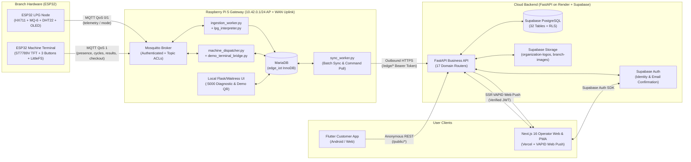

# SpinSense — IoT-Enabled Smart Laundry Management & LPG Safety Platform

SpinSense is a multi-tenant, organization-isolated IoT laundry management platform built around two core operational contributions: **end-to-end incident response** and **LPG fuel & safety continuity**, supported by multi-branch fleet management and anonymous public customer availability.

This repository is a complete full-stack monorepo spanning embedded ESP32 firmware, a Raspberry Pi 5 edge gateway (MQTT + MariaDB + local Flask diagnostic UI), a FastAPI cloud API backed by Supabase Auth & PostgreSQL, a Next.js operator web application / installable PWA, and a Flutter customer mobile app.

> **Source-of-truth documents:**
> - Product requirements, module IDs, and evaluation criteria: [docs/PRD.md](docs/PRD.md)
> - UI design tokens and mobile-first styling contract: [docs/DESIGN.md](docs/DESIGN.md)
> - Gateway pairing and device discovery blueprint: [docs/GATEWAY_DEVICE_ONBOARDING_PLAN.md](docs/GATEWAY_DEVICE_ONBOARDING_PLAN.md)
> - Customer mobile app blueprint: [docs/CUSTOMER_APP_PLAN.md](docs/CUSTOMER_APP_PLAN.md)
> - Pi 5 live rollout runbook: [pi5/DEPLOYMENT.md](pi5/DEPLOYMENT.md)
> - Architecture Decision Records (ADRs): [docs/decisions/](docs/decisions/001-edge-first-mariadb-and-idempotent-sync.md)

---

## Table of Contents

1. [Problem Statement & User Roles](#1-problem-statement--user-roles)
2. [System Architecture](#2-system-architecture)
3. [Repository Structure](#3-repository-structure)
4. [Embedded Hardware & Firmware (`firmware/`)](#4-embedded-hardware--firmware-firmware)
5. [Edge Gateway Layer (`pi5/`)](#5-edge-gateway-layer-pi5)
6. [Cloud Backend & Database (`backend/`)](#6-cloud-backend--database-backend)
7. [Operator Web App & PWA (`frontend-web/`)](#7-operator-web-app--pwa-frontend-web)
8. [Customer Mobile App (`mobile-app/`)](#8-customer-mobile-app-mobile-app)
9. [Architecture Decision Records (ADRs)](#9-architecture-decision-records-adrs)
10. [Local Setup & Development Commands](#10-local-setup--development-commands)
11. [Deployment & Configuration Reference](#11-deployment--configuration-reference)
12. [Verification, Testing & Evaluation Protocol](#12-verification-testing--evaluation-protocol)

---

## 1. Problem Statement & User Roles

**Problem statement:** *How might we help operators keep a laundromat running, respond to developing problems, and give customers trustworthy availability information across web and mobile?*

SpinSense addresses this through an explicit physical-to-cloud evidence pipeline: raw sensor samples become validated local observations, hysteresis-filtered edge conditions, durable incidents, scoped operator notifications, specialist maintenance actions, and verified resolutions—while continuing local monitoring during WAN outages.

### User Personas & Client Strategy

| Role | Client | Access Scope & Responsibilities |
|---|---|---|
| **Owner** | Next.js Web / PWA | Creates organization, uploads public logo, approves/rejects staff join requests, assigns roles/branches, creates/edits/publishes branches, pairs gateways & approves devices, views all-branch analytics & estimated revenue, triages customer reports & incidents. |
| **Branch Manager** | Next.js Web / PWA | Operates assigned branches: overview, machine & LPG controls, customer-report triage, incident resolution, assigned-branch analytics, and **view-only** branch personnel. Cannot manage organization settings, staffing, or hardware pairing. |
| **Machine Maintenance** | Next.js Web / PWA | Inspects and services `washer`, `dryer`, and `washer_dryer` units in assigned branches; runs test cycle controls (`start`/`pause`/`resume`/`stop` with safety confirmation); logs manual repairs (`Complete Service & Return Online` auto-resolves active machine breakdown incidents). No financial/pricing writes or LPG access. |
| **LPG Maintenance** | Next.js Web / PWA | Inspects and services LPG cylinders & safety nodes in assigned branches (`Gas Calibration`, `Set Tare Weight`, `Swap Tank`, general maintenance pause/resume, manual service logs, and clearance-gated LPG incident resolution). No financial views or machine controls. |
| **Customer** | Flutter App (Android) | Anonymous cross-organization branch discovery (map & list, search, filters, on-demand Near Me, regular open-now status, 90-day relative peak demand hours, branch gallery), freshness-gated machine availability & countdowns, and idempotent problem reporting. |

---

## 2. System Architecture

SpinSense uses an **edge-first, outbound-HTTPS** architecture across four tiers so branch operations never rely on inbound internet ports or a cloud MQTT broker.



### Key Architectural Data Flows

1. **Telemetry Ingestion & Durable Sync:**
   `ESP32 → Mosquitto (branch AP 10.42.0.1:1883) → ingestion_worker.py → lpg_interpreter.py → MariaDB (is_synced = 0) → sync_worker.py (50-record HTTPS batch) → FastAPI POST /edge/sync → Supabase PostgreSQL → explicit accepted_ids → MariaDB (is_synced = 1)`
2. **Cloud-to-Edge Command Path:**
   `Operator Web/PWA → FastAPI (HTTP 202, command_id + TTL) → Supabase PostgreSQL → sync_worker.py poll (/edge/machine-commands | /edge/lpg-commands) → MariaDB → machine_dispatcher.py → local MQTT commands → ESP32/Simulator ACK → command-results → MariaDB → FastAPI (/edge/*-command-results) → Operator UI`
3. **Edge Incident & Clearance-Gated Resolution:**
   `lpg_interpreter.py / machine ingestion → edge_condition_states + edge_incident_outbox → POST /edge/incidents → public.incidents & incident_events → notification inbox + VAPID Web Push → Technician Service / Clearance-Gated Resolution`
4. **Local Demo Checkout Path (Pi-LAN Extension):**
   `Customer presses ESP32 Select → demo_terminal_bridge.py → demo_checkouts row + QR URL → Phone on SpinSense-GW AP completes demo payment → demo_checkout.py → queued START command → machine_dispatcher.py → ESP32 countdown & "Wash complete!"`

---

## 3. Repository Structure

| Path | Role & Contents |
|---|---|
| `backend/` | FastAPI application (`main.py`), 18 domain/helper modules, `pyproject.toml`, `requirements*.txt`, PostgreSQL migrations (`migrations/001`–`016`), manual DB/rehearsal scripts (`scripts/`), and pytest suites (`tests/`). |
| `frontend-web/` | Next.js 16 App Router operator web & PWA (`app/`, `components/`, `lib/`, `types/`, `public/sw.js`), Tailwind CSS v4 theme (`app/globals.css`), resilient Leaflet OSM tile loader (`lib/maps/tileLayer.ts`), Vitest unit suites (`tests/unit/`), and Playwright E2E specs (`tests/e2e/`). |
| `mobile-app/mobile-app/` | Flutter 3 customer-only app (`lib/screens/`, `lib/widgets/`, `lib/services/`, `lib/models/`, `lib/theme/`, `lib/config/`), brand assets (`assets/spinsense.svg` + Android mipmap launcher icons), and 6 widget/API/service test suites (`test/`). |
| `pi5/` | Raspberry Pi 5 edge workers (`ingestion_worker.py`, `sync_worker.py`, `lpg_interpreter.py`, `gateway_config.py`, `machine_dispatcher.py`, `machine_simulator.py`, `simulator_core.py`, `demo_checkout.py`, `demo_terminal_bridge.py`), local Flask/Waitress dashboard (`dashboard/`), MariaDB migrations (`migrations/001`–`014`), Mosquitto/systemd cutover templates (`cutover/`), deployment runbook (`DEPLOYMENT.md`), maintenance scripts (`scripts/`), and pytest + Node UI tests (`tests/`). |
| `firmware/` | PlatformIO Arduino-framework ESP32 projects: `esp32-lpg-monitor/` (physical sensor & scale node) and `esp32-machine-terminal/` (simulated washer & TFT QR terminal). |
| `.github/workflows/` | Automated CI workflows, including `build-customer-apk.yml` (pinned Flutter `3.41.9` analyze, test, and Android release APK artifact build). |
| `scripts/` | Cross-portal Node development supervisors (`dev.mjs`, `dev-mobile.mjs`, `dev-all.mjs`, `dev-common.mjs`). |
| `docs/` | Product specifications (`PRD.md`, `DESIGN.md`), blueprints (`GATEWAY_DEVICE_ONBOARDING_PLAN.md`, `CUSTOMER_APP_PLAN.md`), ADRs (`decisions/001`–`006`), vendor references (`VENDOR_MQTT_REQUIREMENTS.md`, `VENDOR_MACHINE_UI_REFERENCE.md`), and progress/reference files. |
| `render.yaml` | Render web service blueprint for `spinsense-api` (`backend/`, Singapore region, including Supabase, CORS, and VAPID env keys). |
| `package.json` | Root workspace scripts (`npm run dev`, `npm run dev:mobile`, `npm run dev:all`). |

---

## 4. Embedded Hardware & Firmware (`firmware/`)

Both ESP32 nodes target `board = esp32dev` under PlatformIO (`framework = arduino`, `monitor_speed = 115200`) and keep Wi-Fi/MQTT/branch credentials in git-ignored local headers (`device_config.h`, `terminal_config.h`) copied from `*.example.h`.

### 4.1 Physical LPG & Environment Monitor (`firmware/esp32-lpg-monitor/`)

Monitors one physical weighing station, ambient temperature/humidity, and combustible gas voltage, displaying status locally on an SSD1306 OLED and publishing telemetry over MQTT.

- **Libraries:** `Adafruit DHT` (`^1.4.6`), `HX711` (`^0.7.5`), `Adafruit SSD1306` (`^2.5.13`), `Adafruit GFX` (`^1.11.11`), `PubSubClient` (`^2.8`).
- **Hardware Pin Mapping (`src/main.cpp`):**

| Peripheral | ESP32 Pin / Bus | Notes |
|---|---|---|
| **HX711 Load Cell Amp** | `GPIO27` (`DOUT`), `GPIO14` (`SCK`) | `CALIBRATION_FACTOR = 20632.40`; commercial mode `TARE_CYLINDER_KG = 15.2`, `NOMINAL_GAS_CAP_KG = 14.0`; bench mode `BENCH_MAX_KG = 5.0` (`BENCH_TEST_MODE`). |
| **MQ-6 Gas Sensor** | `GPIO34` (ADC1, 12-bit, `ADC_11db`) | Outputs `mq6_raw_adc` (0–4095) and calibrated `voltage` (`analogReadMilliVolts`). |
| **DHT22 Temp/Humidity** | `GPIO18` | Sampled every `2000 ms`; failed reads emit `null` with `temperature_valid: false` / `humidity_valid: false` instead of zero. |
| **SSD1306 OLED (128×64)** | I2C `GPIO21` (`SDA`), `GPIO22` (`SCL`), addr `0x3C` | Refreshed every `250 ms` (`4 Hz`); displays Wi-Fi/MQTT status, node mode (`OK`/`LOW`/`MNT`), gross/gas kg, fill bar, temp, and MQ-6 voltage. |

- **MQTT Topics & Cadence:**
  - Publishes every `5000 ms` to `branches/{branch_id}/devices/{device_id}/telemetry` with `device_id`, random `boot_id`, monotonic `sequence`, `quality` flags, and `data` (`mq6_raw_adc`, `voltage`, `temperature`, `humidity`, `lpg_weight_kg`, `gross_weight_kg`, `lpg_percent`, `sequence`).
  - Subscribes (QoS 1) to `branches/{branch_id}/devices/{device_id}/mode` for edge-driven display mode updates (`online`, `low`, `maintenance`).

### 4.2 Simulated Washer & Checkout Terminal (`firmware/esp32-machine-terminal/`)

Acts as a physical-display simulated washer (`washer-sim-01`) with persistent LittleFS state (`/washer.json`), a 240×320 SPI TFT UI, three physical tactile buttons, QR code rendering for local demo checkouts, and full remote command execution (`src/machine_engine.h`).

- **Libraries:** `Adafruit ST7735 and ST7789` (`^1.10.3`), `Adafruit GFX`, `PubSubClient`, `ArduinoJson` (`^6.21.5`), `ricmoo/QRCode`.
- **Hardware Pin Mapping (`README.md` / `terminal_config.example.h`):**
  - ST7789V SPI TFT: `SCL = GPIO18`, `SDA = GPIO23`, `CS = GPIO5`, `DC = GPIO16`, `RST = GPIO17`, `VCC = 3V3`.
  - Tactile buttons (`INPUT_PULLUP` to `GND`): **Up** = `GPIO32`, **Down** = `GPIO33`, **Select / Back** = `GPIO25`. Holding Up + Down for 2 seconds rotates through simulated faults (`E01`–`E05`).
- **Capabilities:**
  - Stores up to **6 saved programs** in LittleFS (`quick` RM 4.00 / 30s, `standard` RM 6.00 / 60s, plus custom `p_<hex>` programs).
  - Executes `start` (with SHA-256 `settings_hash` pinning), `pause`, `resume`, `stop`, `set_settings`, `delete_program`, `inject_fault`, `start_maintenance`, and `clear_fault`, deduplicating by `command_id` and checking `expires_epoch_ms` before execution.
  - Emits MQTT presence (`presence`), samples (`telemetry`), cycle outcomes (`cycle-events` with Malaysia-day split running seconds), and correlated `command-results`.

---

## 5. Edge Gateway Layer (`pi5/`)

The Raspberry Pi 5 runs the local branch gateway stack: an isolated Wi-Fi access point (`wlan0` at `10.42.0.1/24` via `hostapd`/`dnsmasq`), upstream internet (`wlan1`), an authenticated Mosquitto 2.x broker bound exclusively to `10.42.0.1:1883`, MariaDB 11.x (`edge_iot`), Python worker services, and a local Flask/Waitress diagnostic dashboard.

### 5.1 Edge Workers & Responsibilities

| Module | Responsibility |
|---|---|
| `pi5/gateway_config.py` | Manages persistent gateway identity/256-bit credential (`/var/lib/spinsense/gateway.json`, mode `0600`), local MariaDB binding state, and `device_registry` synchronization. |
| `pi5/ingestion_worker.py` | Subscribes to `branches/{branch_id}/devices/+/telemetry`, `presence`, and `cycle-events`. Deduplicates by `(device_id, boot_id, sequence)`, stages unknown attributable devices into `device_discoveries`, evaluates LPG/thermal conditions via `lpg_interpreter.py`, pushes node mode (`online`/`low`/`maintenance`) over MQTT, and persists cycles/presence transactionally in MariaDB. |
| `pi5/lpg_interpreter.py` | **Single source of truth** for LPG & environment interpretation: converts MQ-6 voltage to sensor resistance $R_s$ and clean-air $R_0$, fits the Winsen MQ-6 log-log curve (`MQ6_CURVE_A = 1000.0`, `MQ6_CURVE_B = -2.42`), computes net fuel mass (`gross - tare`) and capacity percentage, enforces tank-swap scale stability (`DEFAULT_STABILITY_TOLERANCE_KG = 0.25 kg` across 3 valid samples), and drives enclosed-room gas & thermal state machines: short elevated-PPM bursts (`< 60s`) clear cleanly without escalation, sustained elevated PPM (`>= 60s`) or `>= gas_crit_ppm` upgrades in-place to `GAS_CRITICAL` with `60s` live heartbeats, and high temperature enters above `45 °C` / recovers below `43 °C`. Low LPG fuel level is treated as a replenishment reminder only, never a cloud incident. |
| `pi5/sync_worker.py` | Outbound HTTPS loop (`2.0s` base interval, up to `60.0s` exponential backoff): refreshes `/edge/config`, uploads pending discoveries (`/edge/discoveries`), syncs telemetry batches (`/edge/sync`, 50 rows/batch, handles `accepted_ids` and `quarantine_reasons`), syncs `lpg-presence` & `lpg-state`, backfills `machine-cycles`, uploads `edge/incidents`, and polls `edge/machine-commands` + `edge/lpg-commands` and uploads correlated results. |
| `pi5/machine_dispatcher.py` | Polls `machine_commands` in MariaDB, expires stale queued/published commands, blocks settings edits during active unpaid QR checkouts, publishes QoS 1 MQTT commands, and records correlated `command-results`. |
| `pi5/machine_simulator.py` & `simulator_core.py` | Software-based machine simulator (`washer`, `dryer`, `washer_dryer`) backed by SQLite for simulated branches/units, supporting the exact same MQTT command/ACK and cycle-event protocol as the ESP32 terminal. |
| `pi5/demo_checkout.py` & `demo_terminal_bridge.py` | Bridges ESP32 terminal `select` / `cancel` MQTT requests to `demo_checkouts` rows and signed phone checkout URLs (`10.42.0.1:5000/demo/...`). |
| `pi5/dashboard/` | Waitress-served Flask app (`dashboard.py`, `index.html`) bound to `10.42.0.1:5000` with HTTP Basic installer pairing auth, staff session auth, CSRF protection, overview analytics charts, local machine/LPG status, Programs Catalog editor, uncommissioned device diagnostics, and guest demo checkout page. |

### 5.2 Local MariaDB Schema (`pi5/migrations/001`–`014`)

- `001_gateway_onboarding.sql` – `002_dashboard_device_scope.sql`: `gateway_configuration`, `device_registry`, `device_discoveries`, and attributed `sensor_telemetry` columns (`gateway_id`, `record_id`, `boot_id`, `source_sequence`, `source_kind`, `cloud_acknowledged_at`, `quarantine_reason`).
- `003_machine_commands.sql` – `008_machine_cycle_cloud_ack.sql`: `machine_commands`, `machine_cycles`, `machine_cycle_daily_runtime`, `demo_checkouts`, `machine_presence`, and cloud cycle ACK flags.
- `009_lpg_maintenance_and_gas.sql` – `014_lpg_presence_and_retention.sql`: `lpg_node_config`, `lpg_maintenance_sessions`, bench gas threshold columns, `edge_condition_states`, `edge_incident_outbox`, general LPG maintenance, and `lpg_presence`.

---

## 6. Cloud Backend & Database (`backend/`)

Built with **FastAPI**, **Pydantic v2**, **psycopg 3** (PostgreSQL connection pool), **HTTPX**, and **pywebpush**, deployed via `backend/main.py`. An HTTP middleware (`retire_unsecured_prototype`) returns `410 Gone` for any legacy unmigrated prototype route.

### 6.1 FastAPI Domain Modules & API Surface

| Module | Key Endpoints | Responsibility |
|---|---|---|
| `onboarding.py` | `GET /public/organizations`, `GET/POST /onboarding`, `GET/PATCH /me`, `PATCH /organization`, `GET /join-requests`, `POST /join-requests/{id}/decision`, `POST /public/registration-email-check` | Verified Supabase JWT validation, idempotent organization/owner & personnel-request provisioning, profile updates, join request approval/rejection, and `app_metadata.role` sync. |
| `branches.py` | `GET/POST /branches`, `GET/PATCH/DELETE /branches/{id}`, `GET /branches/manager-options`, `GET /branches/{id}/overview`, `GET/POST/PATCH/DELETE /branches/{id}/images*`, `GET/PATCH/PUT/DELETE /personnel*`, `GET /branches/{id}/customer-reports*`, `POST .../investigate`, `POST .../resolve` | Organization-scoped branch CRUD, primary-manager assignment & handover, branch gallery images (up to 10 PNG/JPEG/WebP), personnel role/branch management, view-only branch personnel, and customer report triage. |
| `branch_schedules.py` | Shared helper (`validate_weekly_hours`, `compute_open_now`) | Validates structured `mon`–`sun` intervals (including overnight windows) and evaluates timezone-aware regular open-now state. |
| `storage_images.py` | Shared helper (`inspect_image_bytes`, `upload_storage_object`) | Magic-byte, dimension, and size validation for `organization-logos` (`<= 1 MB`) and `branch-images` (`<= 5 MB`) uploaded via service credentials to Supabase Storage. |
| `geocoding.py` | `GET /maps/geocode` | Owner-only cached (`1h`), rate-limited address autocomplete/search proxy defaulting to **Photon**, with optional **LocationIQ**, **Geoapify**, or **Nominatim** (`1 req/s`) backends. |
| `gateways.py` | `POST/GET /branches/{id}/gateway-claims*`, `POST .../cancel`, `POST .../confirm`, `GET /branches/{id}/gateways`, `POST .../revoke`, `GET /branches/{id}/device-discoveries`, `POST .../approve`, `POST /branches/{id}/devices/{id}/retire` | Short-lived base32 pairing code lifecycle, fingerprint verification, atomic gateway cutover/revocation, and pending device approval/retirement. |
| `edge.py` | `POST /edge/claim`, `GET /edge/claim-status`, `GET /edge/config`, `POST /edge/discoveries`, `POST /edge/sync`, `POST /edge/lpg-presence` | Gateway bearer-token authentication (derived branch/org scope), idempotent batch telemetry ingestion, discovery staging, and presence updates. |
| `machine_operations.py` | `POST /edge/machine-cycles/batch`, `POST /edge/machine-state`, `GET /edge/machine-commands`, `POST /edge/machine-command-results`, `GET /branches/{id}/machine-state`, `POST/GET /branches/{id}/machine-commands/{source_id}`, `GET /branches/{id}/machines/{source_id}/statistics` | Cloud machine fleet state (including per-asset `active_incidents_count`), TTL-enforced async remote commands (`202`), correlated command results, cycle history backfill, and per-machine statistics. |
| `lpg_operations.py` | `GET /branches/{id}/lpg-safety`, `GET /branches/{id}/lpg`, `GET/POST .../maintenance-status`, `.../tare-weight`, `.../gas-baseline`, `.../service-maintenance/*`, `.../tank-swap/*`, `GET /edge/lpg-commands`, `POST /edge/lpg-command-results`, `POST /edge/lpg-state` | Live LPG tank & gas/temp/humidity projections (including per-node `active_incidents_count`), unified maintenance lifecycle, scale stability polling, clean-air gas baseline calibration, tare/capacity updates, and gateway-confirmed tank swaps. |
| `fault_catalog.py` | Shared helper (`explain_fault`) | Maps machine fault codes (`E01`–`E05`, `SIM_WATER`, `SIM_DOOR`, `SIM_HEAT`, `SIM_INTERRUPTED`) and SpinSense LPG/thermal rules (`GAS_WARNING`, `GAS_CRITICAL`, `HIGH_TEMP`) to structured troubleshooting guidance; labels unrecognized vendor codes explicitly as `unverified_vendor_code`. |
| `incidents.py` | `POST /edge/incidents`, `GET /branches/{id}/active-incidents-summary`, `GET /incidents`, `GET /incidents/{id}`, `POST /incidents/{id}/acknowledge`, `POST /incidents/{id}/resolve`, `GET/POST/PATCH /maintenance-tasks*` | Idempotent edge incident transition ingestion (excluding `lpg_fuel` reminders), domain-scoped incident inbox/detail (`machine` vs `lpg`) with resolver name/role projection (`resolved_by_name`, `resolved_by_role`), clearance-gated LPG resolution, and hardware-confirmed machine incident auto-resolution (`auto_resolve_machine_incident_from_log` & `reconcile_cleared_machine_incident`). |
| `maintenance_logs.py` | `GET /branches/{id}/maintenance-logs`, `POST /branches/{id}/machines/{source_id}/maintenance-logs`, `POST /branches/{id}/devices/{source_id}/maintenance-logs` | Manual-only maintenance log timeline (`maintenance`, `incident_resolution`, `tank_swap`, `inspection`, `gas_calibration`, `set_tare_weight`); routine preventive maintenance stays unlinked, while completing a machine breakdown repair log automatically clears and resolves the active `machine_fault` incident once the gateway confirms `idle`. |
| `branch_analytics.py` | `GET /organization/analytics`, `GET /branches/{id}/overview/analytics` | Organization and branch-level `day`/`week`/`month` cycle counts, hourly/daily estimated revenue (`Asia/Kuala_Lumpur`), multi-node gas PPM trends, and incident metrics (excluding `lpg_fuel`); never exposed to maintenance specialists. |
| `branch_records.py` | `GET /branches/{id}/records` | Paginated, timezone-filtered historical records partitioned by `scope` (`lpg`, `env`, `machines`), enforcing domain isolation and redacting `price_myr` for `machine_maintenance`. |
| `notifications.py` & `push_notifications.py` | `GET /notifications`, `GET /push/public-key`, `POST/DELETE /push/subscriptions` | Role- and domain-scoped notification inbox plus VAPID Web Push subscription storage and edge-transition dispatch with retry/attempt tracking. |
| `public_customer.py` & `customer_reports.py` | `POST/DELETE /organization/logo`, `GET /public/branches`, `GET /public/branches/{id}/availability`, `POST /public/branches/{id}/machines/{id}/reports` | Cursor-paginated cross-organization public directory, privacy-safe 90-day relative `peak_hours` occupancy profile, freshness-gated availability, rate-limited UUID-idempotent guest report intake, and PII-redacted report projections for specialists. |

### 6.2 Cloud PostgreSQL Migrations (`backend/migrations/001`–`016`)

All tables enable Row-Level Security (RLS) and revoke direct `anon` and `authenticated` table grants:

- `001_onboarding.sql` – `003_personnel_roles.sql`: `organizations`, `profiles`, `memberships`, `join_requests`, `join_request_decisions`, `branches`, `branch_assignments`, and role state constraints.
- `004_gateway_device_onboarding.sql`: `gateways`, `gateway_claims`, `gateway_claim_attempts`, `devices`, `device_discoveries`, `telemetry_observations`.
- `005_machine_remote_commands.sql` – `006_machine_cycle_statistics.sql`, `013_machine_delete_program.sql`: `machine_latest`, `machine_commands`, `machine_cycles`, `machine_cycle_daily_runtime`.
- `007_notifications_and_push.sql`: `push_subscriptions`, `device_notification_states`, `push_delivery_attempts`.
- `008_lpg_tank_swap.sql`, `014_lpg_latest_and_telemetry_indexes.sql` – `016_lpg_tare_and_log_kind_constraints.sql`: `lpg_node_config`, `lpg_maintenance_sessions`, `lpg_commands`, `lpg_latest`, unified maintenance session kinds, and `set_tare_weight` / `gas_calibration` constraints.
- `009_public_customer_portal.sql` – `010_branch_images.sql`: `customer_reports`, `customer_report_history`, `customer_report_rate_limits`, `branch_images`, branch publication/schedule columns, and organization logo paths.
- `011_incidents_and_tasks.sql` – `012_machine_maintenance_logs.sql`: `incidents`, `incident_events`, `maintenance_tasks`, and `machine_maintenance_logs`.

### 6.3 Security & Multi-Tenant Isolation Model

- **Database Defense-in-Depth:** Every cloud table enables PostgreSQL Row-Level Security (RLS) and revokes direct `anon` and `authenticated` table grants; all browser and mobile traffic flows exclusively through FastAPI.
- **Authoritative RBAC:** Supabase Auth verifies identity/credentials, while FastAPI validates every bearer JWT and enforces current PostgreSQL `organizations`, `memberships`, `branch_assignments`, and specialist-domain boundaries on every request (never trusting editable client metadata).
- **Gateway Identity Isolation:** Each Raspberry Pi gateway authenticates with a branch-bound 256-bit bearer credential; FastAPI derives `organization_id` and `branch_id` server-side from the gateway record.
- **Role-Scoped Projections:** Revenue/pricing fields (`price_myr`, analytics) are stripped for maintenance specialists; customer reporter PII (`reporter_name`, `reporter_contact`) is redacted for maintenance specialists; internal diagnostics/telemetry metadata are stripped from anonymous `/public/*` projections.

---

## 7. Operator Web App & PWA (`frontend-web/`)

Built with **Next.js 16.4.6** (App Router), **React 19.2.8**, **TypeScript 5**, **Tailwind CSS v4**, `@supabase/ssr`, **Chart.js 4.6**, **Leaflet 1.9**, and **Lucide React**.

### 7.1 Canonical Routes

- **Public & Auth Flow:** `/`, `/login`, `/register`, `/register/owner`, `/register/personnel`, `/check-email`, `/auth/confirm`, `/membership-status`.
- **Organization Workspace:** `/branches` (streamlined 3-column organization overview KPIs — `Branches`, `Approved personnel`, `Pending requests` — directory, resilient OpenStreetMap `BranchMap`, and owner all-branch `PerformanceChart`), `/branches/new` (branch setup with Leaflet + Photon address picker), `/personnel` (owner-only organization settings, public logo upload, join-request review, staff roles & branch assignments), `/account` (own profile, password update, and Web Push toggle).
- **Per-Branch Workspace (`/branches/[branchId]/...`):**
  - Header (`BranchWorkspaceShell`) displays branch identity, open/closed status, and explicit **Published / Unpublished** customer-app visibility badge.
  - `overview`: 3-column `Infrastructure` KPI row (`Total machines`, `LPG cylinders`, `Branch personnel`), `ActiveIncidentsBanner`, unified `PerformanceChart` (cycles, runtime, estimated revenue, environmental gas PPM, and merged **Incident metrics**), `LpgTankLevelsChart`, and `BranchRecordsTable` (owner / assigned manager).
  - `machines`: Separated Washer, Dryer, and Washer/Dryer cards (`MachineCard` with red **`Attention!`** badge when an incident is active, `MachineDetailModal` with active-incident warning banner, State & Diagnostics, Machine Testing cycle controls, Programs catalog, Parameters, and single-step `Put under maintenance` → `Complete Service & Return Online` auto-resolving active `machine_fault` incidents).
  - `lpg`: Per-node fuel cylinder cards (`LpgCylinderCard` with **`Attention!`** badge when an LPG hazard is active), shared MQ-6 & DHT22 environmental safety panel, unified maintenance modal (`Gas Calibration`, `Set Tare Weight`, `Swap Tank`, general maintenance).
  - `maintenance`: Manual-only domain-filtered maintenance log timeline.
  - `incidents` & `incidents/[incidentId]`: Fault catalog diagnostics, event timeline, **`Resolved by <Staff Name>`** + role badge, `Go to Machines` workflow for machine breakdowns, and clearance-gated resolution for LPG hazards.
  - `customer-reports`: Ongoing Reports & Report History triage with incident linking and PII protection.
  - `hardware-setup`: Resumable Pi gateway pairing, fingerprint verification, pending device approval, and revocation.
  - `personnel` & `details`: Branch personnel (owner manage / manager view-only) and owner-only branch metadata, structured weekly hours, dedicated **Customer App Visibility** publish section with public-availability notice, and branch photo gallery manager.
  - Legacy `/dashboard` remains gated.

### 7.2 PWA, Maps & Design System

- **PWA (`app/manifest.ts` & `public/sw.js`):** Standalone manifest (`start_url: "/branches"`, `background_color: "#171719"`, `theme_color: "#14243a"`) and a **push-only Service Worker** that handles VAPID `push` notifications and `notificationclick` deep-link routing while performing **zero** caching of protected APIs, auth sessions, or map tiles.
- **Resilient OpenStreetMap Tiles (`lib/maps/tileLayer.ts`):** Both `BranchMap` and `BranchLocationPicker` use standard `https://tile.openstreetmap.org/{z}/{x}/{y}.png` as primary and automatically fall back to CARTO Voyager (`basemaps.cartocdn.com`) if consecutive tile errors occur with zero successful loads.
- **Visual Language (`docs/DESIGN.md` & `app/globals.css`):** Charcoal-dark palette (`canvas: #171719`, `surface: #131217`, `raised: #212023`, `navy: #14243a`, `ink: #f2f2f3`, `accent: #ef6268`, `positive: #79c5a6`, `warning: #dfb463`, `negative: #ef8798`), Manrope typography, minimum `44px` (`min-h-11 min-w-11`) mobile-first touch targets, and bottom-left floating `ActionToast` notifications.

---

## 8. Customer Mobile App (`mobile-app/`)

Located at `mobile-app/mobile-app/`, built with **Flutter 3.41.9** (Dart SDK `^3.11.5`), `flutter_map` (`^8.3.2`), `latlong2`, `geolocator` (`^14.1.2`), `url_launcher`, `google_fonts`, `flutter_svg`, and `uuid`. Defaults `SPINSENSE_API_URL` to the hosted Render API (`https://esp32-gas-api.onrender.com`) with a `30s` cold-start-tolerant request timeout in `PublicApiService`.

- **`DiscoveryScreen` (`lib/screens/discovery_screen.dart`):** Branded `AppBar` with `SpinSenseBrandMark` (`assets/spinsense.svg`) and matching Android launcher icons (`mipmap-mdpi` through `mipmap-xxxhdpi`). Anonymous cross-organization map and synchronized paginated list (`GET /public/branches`) with company logo markers (initials fallback), branch cover thumbnails, search, `DiscoveryFilterSheet` (organization, machine type, minimum capacity, availability, regular open-now), and opt-in foreground **Near me** sorting (loads all matching pages before sorting locally without transmitting user coordinates).
- **`BranchDetailScreen` (`lib/screens/branch_detail_screen.dart`):** Displays branch header, service status badge, timezone-aware open-now status, `WeeklyHoursCard`, `BranchImagesGallery` (full-screen swipe/arrow viewer), `PeakDemandHoursCard` (90-day normalized `0–100%` `Overall` + `Mon`–`Sun` busyness bars), external Maps directions & phone dialer via `url_launcher` (Android 11–15+ `<queries>` declared in `AndroidManifest.xml`), and grouped machine cards (`Washers`, `Dryers`, `Washer/Dryers`) with `PublicMachineSheet`. Internal telemetry metadata (freshness age, source timestamps, fault codes, LPG levels, staff info) is intentionally hidden from customer UI.
- **`ReportProblemScreen` (`lib/screens/report_problem_screen.dart`):** Guest machine problem intake (`POST /public/branches/{id}/machines/{machineId}/reports`) with 7 fixed categories (`payment_qr`, `wont_start`, `door_lock`, `stopped_or_faulted`, `wash_dry_result`, `cleanliness`, `other`), 10–1,000 char description, optional single contact channel with explicit consent, and client-generated UUID idempotency.
- **Automated Android APK Builds (`.github/workflows/build-customer-apk.yml`):** Pinned to Flutter `3.41.9` on `ubuntu-latest`; runs `flutter analyze`, `flutter test`, builds `app-release.apk`, and publishes `spinsense-customer-apk` as a downloadable GitHub Actions artifact on pushes to `master` or manual workflow dispatch.

---

## 9. Architecture Decision Records (ADRs)

Key design choices, alternatives considered, and architectural trade-offs are documented in `docs/decisions/`:

| ADR | Title | Summary |
|---|---|---|
| [ADR-001](docs/decisions/001-edge-first-mariadb-and-idempotent-sync.md) | Edge-First MariaDB Persistence & Idempotent Batch Sync | Why telemetry, cycles, and incidents persist in Pi MariaDB before bounded HTTPS batch sync rather than direct ESP32-to-cloud or DB replication. |
| [ADR-002](docs/decisions/002-supabase-auth-and-fastapi-authoritative-rbac.md) | Supabase Auth + FastAPI-Authoritative RBAC & RLS | Why FastAPI + PostgreSQL current-record checks and RLS govern authorization over client JWT claims or direct browser PostgREST CRUD. |
| [ADR-003](docs/decisions/003-single-source-edge-lpg-interpretation.md) | Single-Source Edge LPG Interpretation & Hysteresis | Why `pi5/lpg_interpreter.py` owns mass separation, MQ-6 Rs/R0 estimation, and 3-sample hysteresis/escalation across edge and cloud. |
| [ADR-004](docs/decisions/004-gateway-pairing-and-mqtt-topic-isolation.md) | Dual-Screen Gateway Pairing & Topic-Scoped MQTT Discovery | Why gateways pair via hashed claim codes + visual fingerprints and unknown MQTT publishers stage as pending discoveries. |
| [ADR-005](docs/decisions/005-cloud-to-edge-command-queue-with-correlated-ack.md) | Cloud-to-Edge Command Queue with TTL & Correlated ACKs | Why remote controls use outbound polling, dual-layer TTL expiry, and correlated device ACKs instead of inbound tunnels or retained MQTT. |
| [ADR-006](docs/decisions/006-dual-client-strategy-operator-pwa-and-customer-flutter.md) | Dual-Client Strategy: Operator PWA + Customer Flutter App | Why operators use a Next.js Web/PWA and customers use an anonymous cross-organization Flutter app sharing FastAPI contracts. |

---

## 10. Local Setup & Development Commands

### Prerequisites

- **Node.js** `22.12+` and `npm`
- **Python** `3.11+` virtual environment at `backend/.venv-phase2`
- **Flutter SDK** (`^3.11.5` Dart SDK) for the mobile app
- **PlatformIO Core** (`6.2+`) for compiling ESP32 firmware
- Configured **Supabase project** with `backend/migrations/001`–`016` applied and Storage buckets `organization-logos` & `branch-images` created

### One-Time Dependency Installation

```powershell
# 1. Operator web dependencies
npm --prefix frontend-web ci

# 2. Backend + test dependencies (Windows Phase 2 venv)
backend/.venv-phase2/Scripts/python.exe -m pip install -r backend/requirements-dev.txt

# 3. Flutter dependencies
cd mobile-app/mobile-app && flutter pub get
```

### Unified Local Launchers (from Repository Root)

| Command | Services Started | Notes |
|---|---|---|
| `npm run dev` | FastAPI (`127.0.0.1:8000`) + Next.js (`localhost:3000`) | Logs to one terminal; `Ctrl+C` stops both process trees. Refuses to start if port `8000` or `3000` is occupied. |
| `npm run dev:mobile` | FastAPI (`127.0.0.1:8000`) + Flutter Customer App (Chrome `5173` by default) | Automatically merges CORS origin; accepts `-- --device=<id>` (e.g., Android emulator uses `10.0.2.2:8000`). |
| `npm run dev:all` | FastAPI (`8000`) + Next.js (`3000`) + Flutter (`5173`/Chrome) | Full cross-portal local testing; `Ctrl+C` or `q` tears down all three process trees. |

> **Windows process cleanup note:** Always stop dev servers cleanly (`Ctrl+C`) and verify ports `8000` and `3000` are free (`netstat -ano | findstr 8000`) so Uvicorn child workers do not remain orphaned.

### Individual Component & Firmware Commands

```powershell
# Backend API only
backend/.venv-phase2/Scripts/python.exe -m uvicorn main:app --app-dir backend --reload

# Next.js web only
npm --prefix frontend-web run dev

# Next.js production build (Webpack mode per Windows Turbopack PostCSS note)
npm --prefix frontend-web run build

# Flutter Android runtime (find device ID via `flutter devices`)
cd mobile-app/mobile-app && flutter run -d <device-id> --dart-define=SPINSENSE_API_URL=http://127.0.0.1:8000

# Compile ESP32 LPG monitor firmware (no upload)
& "$env:USERPROFILE\.platformio\penv\Scripts\platformio.exe" run --project-dir firmware/esp32-lpg-monitor --environment esp32dev

# Compile ESP32 machine terminal firmware (no upload)
& "$env:USERPROFILE\.platformio\penv\Scripts\platformio.exe" run --project-dir firmware/esp32-machine-terminal --environment esp32dev
```

---

## 11. Deployment & Configuration Reference

Never commit populated `.env`, `.env.local`, `device_config.h`, `terminal_config.h`, or gateway credential files.

| Component | Env File / Location | Required Variables |
|---|---|---|
| **Backend (`backend/`)** | Ignored `backend/.env` or Render env settings | `SUPABASE_URL`, `SUPABASE_PUBLISHABLE_KEY`, `SUPABASE_SECRET_KEY`, `DATABASE_URL`, `OPERATOR_ORIGINS`; optional: `VAPID_PUBLIC_KEY`, `VAPID_PRIVATE_KEY`, `VAPID_SUBJECT`, `GEOCODING_PROVIDER` (`photon` default, `locationiq`, `geoapify`, `nominatim`), `LOCATIONIQ_API_KEY`, `GEOAPIFY_API_KEY`, `GEOCODING_USER_AGENT`, `GEOCODING_CONTACT_EMAIL`. |
| **Web (`frontend-web/`)** | Ignored `frontend-web/.env.local` (from `.env.example`) | `NEXT_PUBLIC_SUPABASE_URL`, `NEXT_PUBLIC_SUPABASE_PUBLISHABLE_KEY`, `NEXT_PUBLIC_SITE_URL` (`http://localhost:3000` in dev), `NEXT_PUBLIC_API_URL` (`http://127.0.0.1:8000` in dev). |
| **Pi 5 (`pi5/`)** | Mode `0600` env file outside repo (from `pi5/.env.example`) | `SPINSENSE_DB_HOST`, `SPINSENSE_DB_USER`, `SPINSENSE_DB_PASSWORD`, `SPINSENSE_DB_NAME`, `SPINSENSE_CLOUD_BASE` (HTTPS), `SPINSENSE_CREDENTIALS_FILE`, `MQTT_BROKER` (`10.42.0.1`), `MQTT_PORT`, `MQTT_USERNAME`, `MQTT_PASSWORD`, `SPINSENSE_DASHBOARD_BIND`, `SPINSENSE_SETUP_*`, `SPINSENSE_STAFF_*`, `SPINSENSE_COMMAND_MQTT_*`, `SPINSENSE_TERMINAL_*`. |
| **Flutter (`mobile-app/`)** | Build-time `--dart-define` (`lib/config/app_config.dart`) | `SPINSENSE_API_URL`, optional `OSM_TILE_URL_TEMPLATE`, `OSM_TILE_USER_AGENT`. |

- **Cloud Hosting Topology (Demo & Production):**
  - **Operator Web (`frontend-web/`):** Hosted on **Vercel** (`Root Directory: frontend-web`, all 4 `NEXT_PUBLIC_*` keys set as standard Config, not Sensitive; `25s` GET / `30s` write backend fetch timeouts for Render wake-up resilience).
  - **Cloud API (`backend/`):** Hosted on **Render** (`spinsense-api`, Singapore region per [render.yaml](render.yaml)); add the Vercel HTTPS origin to `OPERATOR_ORIGINS` and configure Supabase Auth **Redirect URLs** (`/auth/confirm`, `/auth/reset-password`). Active Pi 5 gateway polling keeps the Render free-tier instance warm during live demonstrations.
  - **Customer Android APK (`mobile-app/mobile-app/`):** Built automatically via `.github/workflows/build-customer-apk.yml` (`spinsense-customer-apk` artifact) pointing to the Render HTTPS API.
  - **Pi 5 Live Rollout:** Follow [pi5/DEPLOYMENT.md](pi5/DEPLOYMENT.md) for MariaDB backups, isolated migration rehearsals, Mosquitto `10.42.0.1` ACL setup, and systemd service restarts.

---

## 12. Verification, Testing & Evaluation Protocol

### Automated Test Suites

| Subsystem | Command | Scope & Coverage |
|---|---|---|
| **Backend (`backend/tests/`)** | `backend/.venv-phase2/Scripts/python.exe -m pytest backend -q` | 16 pytest suites (`182 passed, 2 skipped` locally) covering onboarding, branches, gateways, machine/LPG operations, fault catalog, incidents, maintenance logs, analytics, records, notifications, push, geocoding, public customer APIs, and gateway DB/migration checks (live DB checks skip unless `TEST_DATABASE_URL` is set). |
| **Pi 5 Edge (`pi5/tests/`)** | `backend/.venv-phase2/Scripts/python.exe -m pytest pi5 -q` | 10 pytest suites covering `lpg_interpreter`, `sync_worker`, `ingestion_worker`, `machine_dispatcher`, `simulator_core`, `demo_checkout`, dashboard views/setup, LPG history filtering, and AP watchdog. |
| **Pi 5 Dashboard UI** | `node --test pi5/tests/dashboard/notifications.test.mjs pi5/tests/dashboard/overview_analytics.test.mjs` | Node test suites for Pi dashboard notification toasts and overview analytics charts. |
| **Web Unit (`frontend-web/`)** | `npm --prefix frontend-web test` | 34 Vitest unit suites (`226 passed`) covering auth actions/boundaries, onboarding, confirmation, provider boundaries, branch workspace views, merged `PerformanceChart`, resilient OSM tile loader, notifications, and `ActionToast`. |
| **Web E2E & Static** | `npm --prefix frontend-web run test:e2e`, `npm --prefix frontend-web run lint`, `npx --no-install tsc --noEmit --incremental false` | Playwright specs (`auth.spec.ts`, `unconfigured.spec.ts`), ESLint, TypeScript check, and production `next build --webpack`. |
| **Flutter (`mobile-app/mobile-app/`)** | `flutter analyze` and `flutter test` | Static analysis (`0` issues on Flutter `3.41.9`) and 6 test suites (`26 passed`: `widget_test`, `discovery_widget_test`, `branch_availability_widget_test`, `report_problem_widget_test`, `public_api_service_test`, `location_service_test`). |

### Thesis Evaluation Protocol (PRD Sections 8 & 9)

For the Final Year Project evaluation chapter, SpinSense defines 29 end-to-end verification scenarios (`S-01`–`S-29` in [docs/PRD.md](docs/PRD.md#8-failure-behavior-and-verification-coverage)) and five repeatable quantitative/qualitative acceptance benchmarks ([docs/PRD.md](docs/PRD.md#9-evaluation-protocol-and-acceptance-targets)):

1. **Connected Sensor-to-Screen Latency:** Trace `>= 100` distinct samples across ESP32 acquisition, Pi MariaDB commit, cloud PostgreSQL commit, and client render (`>= 95%` visible within `10s`, reporting p50/p95/max and cold starts separately).
2. **HX711 Weighing Accuracy:** Test 5 known loads (`0%`, `25%`, `50%`, `75%`, `100%` of declared range) × 10 repeated remove/reapply trials (`50` measurements total; target overall `MAE <= 0.02 × (max_mass - min_mass)`).
3. **30-Minute WAN Outage & Restart Recovery:** Block Pi-to-cloud WAN for 30 minutes while keeping branch LAN active, create and clear conditions, restart edge services mid-outage, reconnect WAN, and verify 100% backlog reconciliation with zero duplicate cloud rows or historical alarm floods.
4. **Roles & Incident Correctness (`S-01`, `S-08`, `S-09`, `S-11`, `S-12`, `S-16`–`S-27`, `S-29`):** Cross-organization, cross-branch, and cross-domain rejection, clearance-gated incident resolution, and Android PWA push deep-link checks.
5. **Command & Customer Correctness (`S-10`, `S-13`, `S-29`):** Correlated MQTT ACKs, command expiry/duplicate rejection, anonymous cross-company Android discovery, zero-countdown freshness safety, and idempotent guest problem reporting.

> **Verification boundary:** Mocked unit/widget suites verify software contracts and UI logic in isolation; physical hardware measurements, 30-minute WAN outage trials, live Android device runs, and production Render/Vercel/Pi checks must be executed and recorded separately as thesis experimental evidence.
